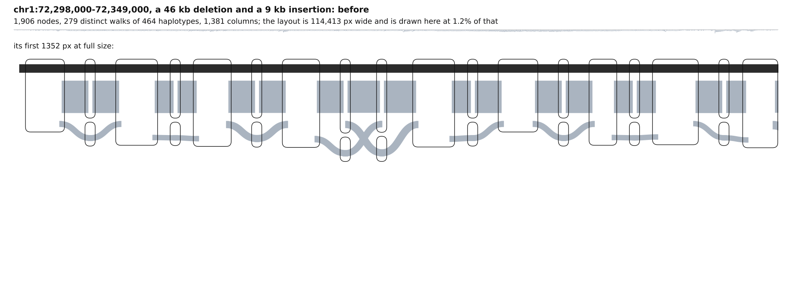
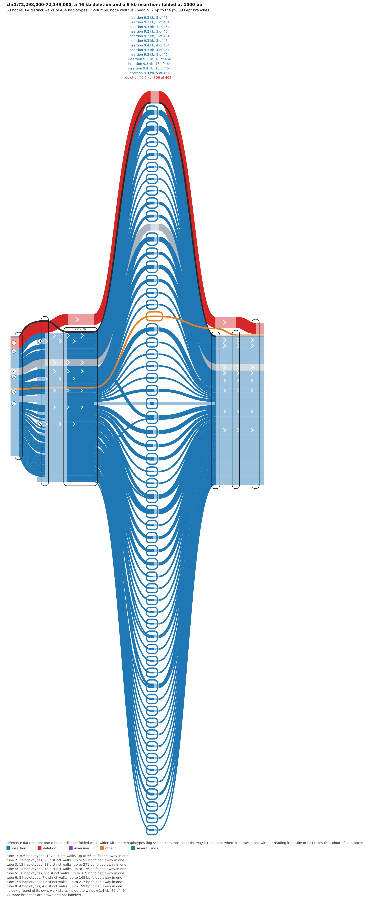
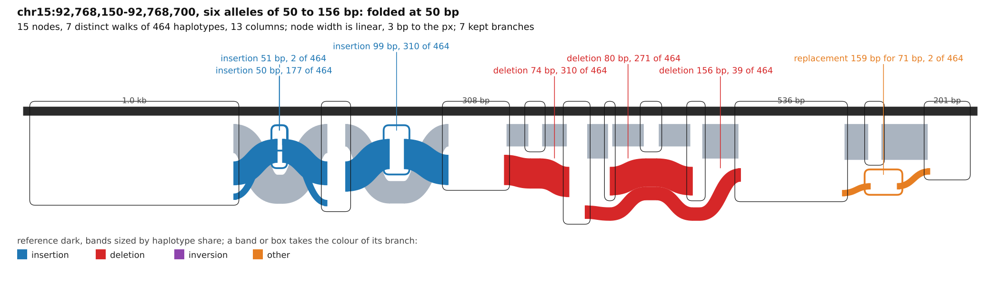
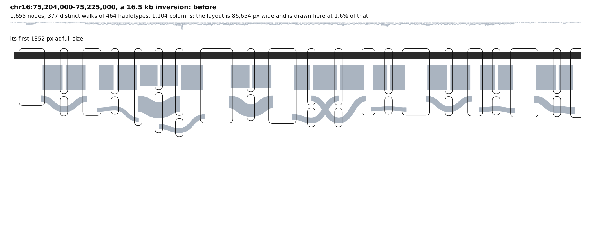

# @jbrowse/graph-fold

graph-fold merges the small variation of a pangenome graph window into its
reference, so a sequence tube map of the window shows its structural variants.
It is a spike: version 0.0.0, not published.

- **In:** the nodes and tracks a tube map is laid out from, as
  [@jbrowse/tubemap-core](https://github.com/GMOD/tubemap-core)'s
  `layoutTubeMap` takes them, with the reference as the first track
- **Out:** fewer nodes and tracks in the same shape, plus what each merged node
  holds, the list of kept branches with their carriers, and what was folded away
  on each walk
- It reads node lengths and never a base, and has no dependencies

A 51 kb window of the HPRC v2.1 Minigraph-Cactus graph,
chr1:72,298,000-72,349,000, lays out 1,381 columns and 114,413 px wide:



Folded at 1000 bp with clustering it is 8 nodes in 7 columns, and the deletion
306 of the 464 haplotypes carry is the widest band:


## Usage

```ts
import { foldGraph } from '@jbrowse/graph-fold'
import { layoutTubeMap } from '@jbrowse/tubemap-core'

const fold = foldGraph(nodes, tracks, {
  threshold: 1000,
  referenceRevisits: tables.revisited,
})
const layout = layoutTubeMap(fold.nodes, fold.tracks, [], layoutOptions)
```

- `nodes` are `{ name, sequenceLength }`; a node with `seq` and no
  `sequenceLength` takes its length from `seq`
- `tracks` are `{ name, sequence, freq, indexOfFirstBase }`, where `sequence`
  lists node names with a `-` prefix for a reversed step and `freq` counts the
  haplotypes that take the walk, 1 when absent
- The call goes between building the nodes and tracks and laying them out.
  Nothing else changes: `fold.nodes` and `fold.tracks` are valid `layoutTubeMap`
  input

## Options

| Option              | Default | Effect                                                                                                 |
| ------------------- | ------- | ------------------------------------------------------------------------------------------------------ |
| `threshold`         | 50      | bp at which a detour is kept as a branch                                                               |
| `cluster`           | false   | Draw near-equal alleles at one site as one branch, marked as a cluster                                 |
| `clusterTolerance`  | 0.05    | How far two alleles may differ, as a share of the larger one's length                                  |
| `reference`         | 0       | Index of the reference track                                                                           |
| `referenceRevisits` | none    | How many nodes the reference passes more than once in the whole graph: graph-walks' `tables.revisited` |

## The rule

- The reference track is the backbone. Each other walk is read as runs: steps on
  reference nodes in one direction and in reference order. Small gaps do not end
  a run, so SNPs inside an inversion leave it one run
- Inside a run, a detour between two consecutive reference steps is big when its
  own length, or the reference it replaces, reaches the threshold. A big detour
  is kept; every other one is merged into the reference
  - own length big, replaced reference small: an insertion, drawn at the left
    breakpoint, and the walk passes the few replaced bp
  - replaced reference big, own length small: a deletion, a jump between two
    backbone nodes
  - both big: a replacement, kind `other`
- A run in the other direction is an inversion. It stays a block the walk takes
  reversed, `A -B C`, and is never a deletion
- A run between two others that spans less reference than the threshold is not a
  run: its bp count as the walk's own sequence there. A repeat of reference
  shorter than the threshold folds the same way
- The first and last run of a walk are never dropped, so an inversion whose
  flanks are shorter than the threshold survives
- Sequence off the reference before a walk's first reference step or after its
  last never rejoins in the window, so it is kept however short. A walk that
  stops the threshold or more short of either end of the reference is drawn
  stopping there
- The backbone is cut at every breakpoint a kept branch or run uses, and each
  piece between two cuts is one merged node
- Walks that fold to the same steps become one track whose `freq` is their sum

## Result

`foldGraph` returns a `FoldResult`:

- `folded` and `reason`: false with the reason when the window is returned as it
  came
- `nodes`: `{ name, sequenceLength, kind, refStart, refEnd, cluster }`, `kind`
  being `reference` for a backbone node and `branch` for any other
- `tracks`: the reference first, then one per distinct folded walk, with `id`,
  `name`, `sequence`, `freq`, `sourceTrackID` and `names`, the input walks it
  stands for
- `members`: for each folded node, the original node names it holds. A backbone
  node lists its reference nodes in order and then the nodes of the variants
  folded into it; an insertion lists the nodes of every allele drawn as it
- `branches`, in reference order:
  - `kind`: `insertion`, `deletion`, `inversion` or `other`, and `description`,
    which says which `other`: `replacement`, `reference walked twice`,
    `walk starts inside the window`, and so on
  - `length`, `insertedBp`, `deletedBp`, `refStart`, `refEnd`: positions are on
    the reference, counted from the reference track's `indexOfFirstBase`
  - `haplotypes`: the summed `freq` of the walks that carry it
  - `nodes`: the folded nodes that are the branch, the insertion's node or the
    inverted backbone nodes; `from` and `to`: the backbone nodes a deletion or
    insertion lies between. A deletion is the step from `from` to `to`
  - `open`: an inversion the window cuts through
  - `cluster` and `alleles`, only on a clustered branch
- `walks`: one per input track, the reference first: `track` is the index of its
  folded track, and
  `originalBp = foldedBp - skippedBp - clippedBp + insertedBp`. `steps` lists
  each step of the folded track where the walk differs from the node drawn:
  `insertedBp` it has and the node lacks, `skippedBp` of the node it leaves out,
  `clippedBp` of the node past the walk's end

`foldProblems(nodes, tracks, result)` lists every broken invariant: a step on a
node that is not there, a jump no branch reports, a haplotype count that
changed, a walk whose bp do not reconcile.

## Clustering

One site of the chr1 window has insertions of 56 lengths from 8.9 to 9.5 kb on
129 haplotypes. Without clustering each is a box:



- With `cluster: true`, alleles of one kind join when their breakpoints and
  lengths each differ by at most `clusterTolerance` of the larger allele. The
  most carried allele is drawn, the others take its node
- Every clustered branch, and its node, carries
  `cluster: { members, minLength, maxLength, haplotypes }`, and the branch lists
  its `alleles`. A renderer should show that the box stands for several lengths
- A walk drawn through a cluster keeps the difference in its `steps`, so its bp
  still reconcile
- Inversions are not clustered

## Graphs it will not fold

A run off the reference is a variant only when the reference passes each node
once. Where it does not, as in a pggb graph with a collapsed repeat, the run may
be a copy of reference sequence, and `foldGraph` returns the input with
`folded: false` and the reason. It decides by `referenceRevisits`, when given
and above 0, and by the reference track of the window itself. NaN, which
graph-walks gives for a header with no count, leaves the window to decide.

## Three windows

HPRC v2.1 Minigraph-Cactus, GRCh38, 464 haplotypes, cut with graph-walks' figure
preset. Layout is tubemap-core's with `nodeWidthOption: 'compressed'`, banded by
`layers: [{ data: 'haplotypes', stat: 'coarsen' }]` and unbanded.

| window          | graph                        | nodes | distinct walks | columns, banded | px wide, banded | columns, unbanded | px wide, unbanded |
| --------------- | ---------------------------- | ----- | -------------- | --------------- | --------------- | ----------------- | ----------------- |
| chr15-alleles   | before                       | 439   | 88             | 297             | 20,828          | 297               | 23,937            |
| chr15-alleles   | folded at 50 bp              | 15    | 7              | 13              | 1,510           | 13                | 1,463             |
| chr15-alleles   | folded at 1000 bp            | 1     | 2              | 1               | 135             | 1                 | 135               |
| chr1-deletion   | before                       | 1,906 | 279            | 1,381           | 114,413         | 1,381             | 124,219           |
| chr1-deletion   | folded at 50 bp              | 65    | 64             | 9               | 1,686           | 9                 | 1,385             |
| chr1-deletion   | folded at 1000 bp            | 63    | 64             | 7               | 1,458           | 7                 | 1,167             |
| chr1-deletion   | folded at 50 bp, clustered   | 10    | 6              | 9               | 1,309           | 9                 | 1,182             |
| chr1-deletion   | folded at 1000 bp, clustered | 8     | 6              | 7               | 1,081           | 7                 | 982               |
| chr16-inversion | before                       | 1,655 | 377            | 1,104           | 86,654          | 1,104             | 156,585           |
| chr16-inversion | folded at 50 bp              | 5     | 4              | 5               | 758             | 5                 | 742               |
| chr16-inversion | folded at 1000 bp            | 3     | 3              | 3               | 504             | 3                 | 491               |

- chr15, folded at 50 bp: insertions of 50 bp (177 haplotypes), 51 bp (2) and 99
  bp (310), deletions of 74 bp (310), 80 bp (271) and 156 bp (39), and a 159 bp
  replacement (2). The reference is the minority allele at three sites
- chr1: the 45.5 kb deletion on 306 of 464 at every threshold tried
- chr16: the 16.6 kb inversion on 439 of 464 at 50, 1000 and 5000 bp, and a 584
  bp deletion on 26 at 50 bp
- Every fold passes `foldProblems`: all 464 haplotypes come out, every step is
  on a folded node, every jump is a reported branch, and every walk's bp
  reconcile






`pnpm fetch` cuts the windows and `pnpm prove` prints the table, checks the
invariants and writes the pictures. The numbers are laid out with
`nodeWidthOption: 'compressed'`; the folded pictures with `'small'` and a
`basesPerPixel` that fits the window, so a node's width is its length.

- `basesPerPixel` is on tubemap-core's `main` and not yet released, so the
  pictures here came from
  `TUBEMAP_CORE=../gmod/tubemap-core/src/index.ts pnpm prove`. Without the
  variable the script uses the installed release, which ignores the option
- The chr15 cut is committed as a test fixture and the other two go to `data/`.
  The before pictures' SVG are not committed, being 5 MB each

## Limits

- **Driven by steps, not graph-walks' departures.** The fold reads the tracks
  both consumers hand to the layout, so it needs no graph-walks types and folds
  a graph from any source. A departure graph-walks reports without steps, one
  that jumps the window or carries more than `attachBp`, is not in the tracks:
  the walk is drawn stopping, and a reader of the branch list sees
  `walk ends inside the window`, not the departure
- **An insertion is its site and its length.** Two alleles of one length at one
  site are one branch whatever their sequence; `members` lists the nodes of both
- **Nothing is nested.** A variant inside a kept insertion changes that
  insertion's length and makes it another allele. A big detour inside an
  inversion is kept; an inversion inside an inversion is untested
- **Close breakpoints leave short backbone nodes.** The chr1 window keeps a 1 bp
  node between a deletion's end and a replacement's end one bp apart
- **A walk that lies wholly inside an inversion** takes every step reversed, as
  does a walk written against the reference. The fold cannot tell them apart,
  reports no inversion for either, and draws both reversed over the merged nodes
- **A haplotype that walks reference twice** keeps both passes when the repeat
  reaches the threshold, as a branch of kind `other`. Synthetic tests only; how
  the layout draws the revisit is untested
- **Fragments are walks.** A haplotype in two tracks counts twice in
  `haplotypes`
- **Reads are not folded.** A read mapped to original nodes has no place on the
  folded ones
- **No pggb window has been run**, only the synthetic gate tests
- The windows were cut with graph-walks 8.0.1, the newest release past the
  three-day `minimumReleaseAge`, and not 9.1.0

## License

MIT
