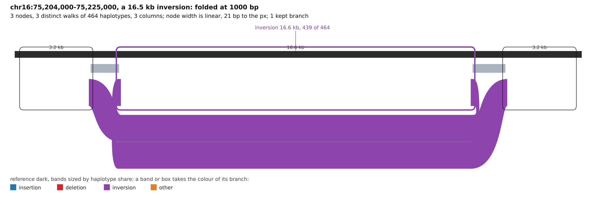
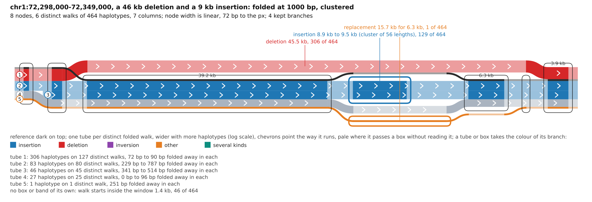
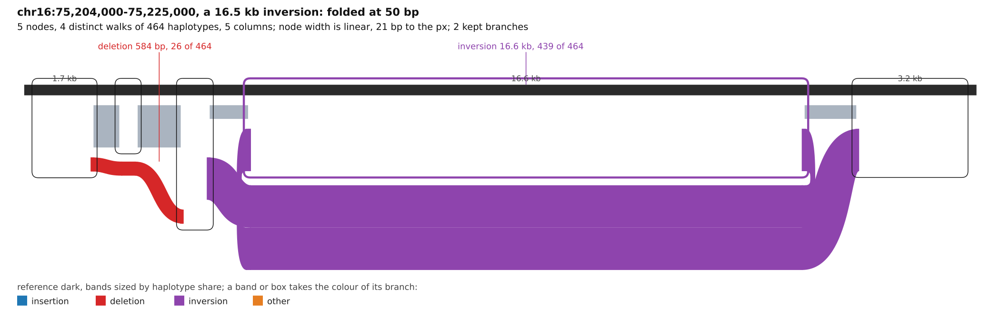

# @jbrowse/graph-fold

graph-fold merges the small variation of a pangenome graph window into its
reference, so a sequence tube map of the window shows its structural variants.

- **In:** the nodes and tracks a tube map is laid out from, as
  [@jbrowse/tubemap-core](https://github.com/GMOD/tubemap-core)'s
  `layoutTubeMap` takes them, with the reference as the first track
- **Out:** fewer nodes and tracks in the same shape, plus what each merged node
  holds, the kept branches with their carriers, and what was folded away on each
  walk
- It reads node lengths and never a base, and has no dependencies

A 21 kb window of the HPRC v2.1 Minigraph-Cactus graph,
chr16:75,204,000-75,225,000, is 1,655 nodes. Folded at 1000 bp it is 3, and the
inversion 439 of its 464 haplotypes carry is a tube that loops back through the
block:



A 51 kb window, chr1:72,298,000-72,349,000, lays out 1,381 columns and 114,413
px wide:


Folded at 1000 bp with clustering it is 8 nodes in 7 columns, and the 306
haplotypes with the deletion pass over 45.5 kb of reference without reading it:



## Install

```bash
npm install @jbrowse/graph-fold
```

## Usage

```ts
import { branchLabel, foldGraph } from '@jbrowse/graph-fold'
import { layoutTubeMap } from '@jbrowse/tubemap-core'

const fold = foldGraph(nodes, tracks, {
  threshold: 1000,
  referenceRevisits: tables.revisited,
})
const layout = layoutTubeMap(fold.nodes, fold.tracks, [], layoutOptions)
if (fold.folded) {
  for (const branch of fold.branches) {
    console.log(branchLabel(branch, fold.haplotypes)) // deletion 45.5 kb, 306 of 464
  }
}
```

- `nodes` are `{ name, sequenceLength }`; a node with `seq` and no
  `sequenceLength` takes its length from `seq`
- `tracks` are `{ name, sequence, freq, indexOfFirstBase, sourceTrackID }`,
  where `sequence` lists node names with a `-` prefix for a reversed step and
  `freq` counts the haplotypes that take the walk, 1 when absent. Any other
  field a track has comes back on the folded track
- The call goes between building the nodes and tracks and laying them out:
  `fold.nodes` and `fold.tracks` are `layoutTubeMap` input whether the window
  folded or not
- Reads are not folded. A read mapped to the original nodes has no place on the
  merged ones, so lay a folded window out without its reads

## Options

| Option              | Default | Effect                                                                                                |
| ------------------- | ------- | ----------------------------------------------------------------------------------------------------- |
| `threshold`         | 50      | bp at which a detour is kept as a branch                                                              |
| `cluster`           | false   | Draw near-equal alleles at one site as one branch, marked as a cluster                                |
| `clusterTolerance`  | 0.05    | How far two alleles may differ, as a share of the larger one's length                                 |
| `reference`         | 0       | Index of the reference track                                                                          |
| `referenceRevisits` | none    | How many nodes the reference passes more than once in the whole graph, see [the gate](#the-gate)      |
| `inversions`        | 'walk'  | `'walk'` steps the reference node reversed; `'box'` steps a copy of it, see [Inversions](#inversions) |

## The rule

- The reference track is the backbone. Each other walk is read as runs: steps on
  reference nodes in one direction and in reference order. Small gaps do not end
  a run, so SNPs inside an inversion leave it one run
- Inside a run, a detour between two consecutive reference steps is big when its
  own length, or the reference it replaces, reaches the threshold. A big detour
  is kept; every other one is merged into the reference
  - own length big, replaced reference small: an insertion, drawn at the left
    breakpoint, and the walk passes the few replaced bp
  - replaced reference big, own length small: a deletion, a jump between two
    backbone nodes
  - both big: a replacement, kind `other`
- A run in the other direction is an inversion. It stays a block the walk takes
  reversed, `A -B C`, and is never a deletion
- A run between two others that spans less reference than the threshold is not a
  run: its bp count as the walk's own sequence there. A repeat of reference
  shorter than the threshold folds the same way
- The first and last run of a walk are never dropped, so an inversion whose
  flanks are shorter than the threshold survives
- Sequence off the reference before a walk's first reference step or after its
  last never rejoins in the window, so it is kept however short. A walk that
  stops the threshold or more short of either end of the reference is drawn
  stopping there
- The backbone is cut at every breakpoint a kept branch or run uses, and each
  piece between two cuts is one merged node
- Walks that fold to the same steps become one track whose `freq` is their sum

## Result

`foldGraph` returns a `FoldResult`, which is `Folded` or `Unfolded` by its
`folded`. Both have:

- `threshold`, and `haplotypes`, the summed `freq` of every input track, the
  reference among them
- `nodes` and `tracks`, `layoutTubeMap` input
- `members`, `branches` and `walks`, empty when `folded` is false

### Unfolded

- `reason` says why the window was not folded
- `nodes` and `tracks` are the arrays the caller passed, untouched

### Folded

- `nodes`:
  `{ name, sequenceLength, kind, refStart, refEnd, cluster, invertedOf }`,
  `kind` being `reference` for a backbone node and `branch` for any other
- `tracks`: the reference first, then one per distinct folded walk. Each is its
  first input walk's own fields, `sourceTrackID` among them, with these set:
  - `id`: its index in `tracks`
  - `name`: the first walk's name, and `names`: every walk's
  - `label`: the one walk's name, or `439 haplotypes`
  - `sequence` and `freq`
  - `sourceTrackID`: its `id` when the input walk had none
  - `variation`: what the track hides, see
    [What a tube hides](#what-a-tube-hides)
- `members`: for each folded node, the original node names it holds. A backbone
  node lists its reference nodes in order and then the nodes of the variants
  folded into it; an insertion lists the nodes of every allele drawn as it
- `branches`, in reference order:
  - `kind`: `insertion`, `deletion`, `inversion` or `other`, and `description`,
    which says which `other`: `replacement`, `reference walked twice`,
    `walk starts inside the window`, and so on
  - `length`, `insertedBp`, `deletedBp`, `refStart`, `refEnd`: positions are on
    the reference, counted from the reference track's `indexOfFirstBase`
  - `haplotypes`: the summed `freq` of the walks that carry it, and `tracks`:
    the `id` of each folded track that does
  - `nodes`: the folded nodes that are the branch, the insertion's node or the
    inverted backbone nodes
  - `from` and `to`: the backbone nodes on either side of it. A deletion is the
    step from `from` to `to`; an inversion at the edge of the window lacks one
    of them
  - `anchored`: false for a branch with no node and no step of its own to label,
    such as `walk ends inside the window`. Its `refStart` and `refEnd` are both
    the position where the walk starts or ends, and `length` the reference it
    leaves unwalked past there. Place it at that position or list it beside the
    picture
  - `open`: an inversion the window cuts through
  - `cluster` and `alleles`, only on a clustered branch
- `walks`: one per input track, in the order of the input: `track` is the `id`
  of its folded track, and
  `originalBp = foldedBp - skippedBp - clippedBp + insertedBp`. `steps` lists
  each step of the folded track where the walk differs from the node drawn:
  `insertedBp` it has and the node lacks, `skippedBp` of the node it leaves out,
  `clippedBp` of the node past the walk's end

### Labels

Every renderer should print the same text, so the package makes it:

- `branchLabel(branch, fold.haplotypes)`: `deletion 45.5 kb, 306 of 464`,
  `replacement 15.7 kb for 6.3 kb, 1 of 464`, and for a cluster its range and
  member count, `insertion 8.9 kb to 9.5 kb (cluster of 56 lengths), 129 of 464`
- `variationLabel(track)`:
  `439 haplotypes on 356 distinct walks, 8 bp to 795 bp folded away in each`
- `bpLabel(bp)`: `584 bp`, `45.5 kb`
- `track.label`, or `trackLabel(freq, names)`
- The reference's `label` is its name, followed by `and 1 identical haplotype`
  where its track came with a `freq` over 1; `referenceLabel(name, freq)` gives
  the same text

`foldProblems(nodes, tracks, result)` lists every broken invariant: a step on a
node that is not there, a jump no branch reports, a haplotype count that
changed, a walk whose bp do not reconcile.

## What a tube hides

A track groups the walks that fold to the same steps in the same directions, so
it is exact about its route and silent about every difference under the
threshold. On chr16 at 1000 bp the looping track is 439 haplotypes and 356
distinct walks. Lowering the threshold separates them: at 50 bp the 439 are a
track of 413 and a track of 26 that carry a 584 bp deletion as well.

- `variation.walks` is how many input walks the track stands for
- `variation.foldedAwayBp` is the `min`, `median` and `max`, over the track's
  haplotypes, of the bp each differs from the nodes drawn: what it has and they
  lack plus what they have and it skips. This is the figure a renderer should
  quote, and `variationLabel` does
- `variation.insertedBp` and `variation.skippedBp` are the two halves, each with
  its own spread. Their sums are not `foldedAwayBp`'s, since the walk with the
  most inserted need not be the one with the most skipped

## Drawing conventions

- **Solid where a tube reads a node, pale where it passes one.** A deletion's
  tube is pale over the reference it leaves out, and an inversion's is pale on
  the two passes under the block and solid on the pass back through it
- **Chevrons point the way the tube runs,** so the pass through an inverted
  block points against the reference
- **A clustered box says it is a cluster,** by `cluster` on the node and the
  branch: `branchLabel` prints the range
- **A copy box says what it copies,** see [Inversions](#inversions)
- **An unanchored branch is listed or placed, never dropped**

## Inversions

By default a carrier's walk is the true one, `A -B C`: it steps the reference
node `B` reversed, and a tube map draws the loop, as in the first picture.

With `inversions: 'box'` the carriers step through a copy of the block instead,
`A inv:B C`, in the direction they travel:


- Use the loop where tubes are drawn one per walk: it is the walk, and nothing
  is drawn twice. Use the box where the picture is banded, since bands are per
  step and draw the loop as two long edges under the block with nothing inside
  it
- A copy node has `kind: 'branch'`, the length and reference span of the node it
  copies, and `invertedOf`, that node's name. The inversion branch's `nodes`
  name the copies, and `members` lists what each holds
- **A renderer must mark a copy.** It is the reference box read backwards, not
  new sequence, and `invertedOf` is the only thing that says so. The picture
  above fills it with arrows against the reference and ties it to the box it
  copies
- A copy is named `inv:` and the node's name. Where an input node has that name
  already, the copy takes a `'` more until none does
- Which steps are the inverted pass is decided walk by walk: a run against the
  direction of the walk's first and last runs. A walk stored back to front with
  no inversion gets no copy, and one with an inversion steps `-inv:B`
- A block that another kept branch cuts is one copy per piece, in the order the
  carrier walks them. An insertion inside the block becomes a node of its own,
  `inv:ins:…`, with no `invertedOf`, listed in the insertion's `nodes` beside
  the node forward carriers take

## Clustering

One site of the chr1 window has insertions of 56 lengths from 8.9 to 9.5 kb on
129 haplotypes. Without clustering each is a box:


- With `cluster: true`, alleles of one kind join when their breakpoints and
  lengths each differ by at most `clusterTolerance` of the larger allele. The
  most carried allele is drawn, the others take its node
- Every clustered branch, and its node, carries
  `cluster: { members, minLength, maxLength, haplotypes }`, and the branch lists
  its `alleles`
- A walk drawn through a cluster keeps the difference in its `steps`, so its bp
  still reconcile
- Inversions are not clustered

## The gate

A run off the reference is a variant only when the reference passes each node
once. Where it does not, as in a graph with a collapsed repeat, the run may be a
copy of reference sequence, and the window comes back unfolded.

- `referenceRevisits` is the number of nodes the reference passes more than once
  anywhere in the graph, not in the window.
  [@jbrowse/graph-walks](https://github.com/GMOD/graph-walks) gives it as
  `tables.revisited`, which is the walk file header's count over the whole file.
  Above 0, the window is not folded
- Absent, 0 or NaN, which graph-walks gives for a header with no count, the fold
  looks at the window alone: it is not folded if its reference track steps a
  node twice
- The count is 0 for Minigraph-Cactus and minigraph graphs, whose reference is
  acyclic. A pggb graph is refused only where its reference revisits a node: a
  pggb graph of four E. coli genomes whose header counts 0 folds, and is a test
  fixture here
- A window is also not folded when it has no reference track, or a track steps a
  node that is not among the nodes; `reason` names the track and node

## Three windows

HPRC v2.1 Minigraph-Cactus, GRCh38, 464 haplotypes, cut with graph-walks' figure
preset. Layout is tubemap-core's with `nodeWidthOption: 'compressed'`, banded by
`layers: [{ data: 'haplotypes', stat: 'coarsen' }]` and unbanded.

| window          | graph                               | nodes | distinct walks | columns, banded | px wide, banded | columns, unbanded | px wide, unbanded |
| --------------- | ----------------------------------- | ----- | -------------- | --------------- | --------------- | ----------------- | ----------------- |
| chr15-alleles   | before                              | 439   | 88             | 297             | 20,828          | 297               | 23,937            |
| chr15-alleles   | folded at 50 bp                     | 15    | 7              | 13              | 1,510           | 13                | 1,463             |
| chr15-alleles   | folded at 1000 bp                   | 1     | 2              | 1               | 135             | 1                 | 135               |
| chr1-deletion   | before                              | 1,906 | 279            | 1,381           | 114,413         | 1,381             | 124,219           |
| chr1-deletion   | folded at 50 bp                     | 65    | 64             | 9               | 1,686           | 9                 | 1,385             |
| chr1-deletion   | folded at 1000 bp                   | 63    | 64             | 7               | 1,458           | 7                 | 1,167             |
| chr1-deletion   | folded at 50 bp, clustered          | 10    | 6              | 9               | 1,309           | 9                 | 1,182             |
| chr1-deletion   | folded at 1000 bp, clustered        | 8     | 6              | 7               | 1,081           | 7                 | 982               |
| chr16-inversion | before                              | 1,655 | 377            | 1,104           | 86,654          | 1,104             | 156,585           |
| chr16-inversion | folded at 50 bp                     | 5     | 4              | 5               | 758             | 5                 | 742               |
| chr16-inversion | folded at 1000 bp                   | 3     | 3              | 3               | 504             | 3                 | 491               |
| chr16-inversion | folded at 1000 bp, inversions boxed | 4     | 3              | 3               | 463             | 3                 | 463               |

- chr15, folded at 50 bp: insertions of 50 bp (177 haplotypes), 51 bp (2) and 99
  bp (310), deletions of 74 bp (310), 80 bp (271) and 156 bp (39), and a 159 bp
  replacement (2). The reference is the minority allele at three sites
- chr1: the 45.5 kb deletion on 306 of 464 at every threshold tried
- chr16: the 16.6 kb inversion on 439 of 464 at 50, 1000 and 5000 bp, and a 584
  bp deletion on 26 at 50 bp
- Every fold passes `foldProblems`: all 464 haplotypes come out, every step is
  on a folded node, every jump is a reported branch, and every walk's bp
  reconcile




- The folded pictures are tubes, one per distinct folded walk, laid out with
  `nodeWidthOption: 'small'`, a `basesPerPixel` that fits the window and
  `freqWidth: 'log'`; linear makes the 439 haplotype tube 6,585 px wide
- chr15 reads better banded, above: its seven walks each carry several alleles,
  so a tube cannot take one branch's colour. `docs/chr15-alleles-fold-50.png` is
  the same fold as tubes, and
  `docs/chr1-deletion-fold-1000-clustered-banded.png` the chr1 fold banded
- `pnpm fetch` cuts the windows and `pnpm prove` prints the table, checks the
  invariants and writes the pictures. `TUBEMAP_CORE` and `GRAPH_WALKS` name
  another build of either package for the scripts to import

## Limits

- **Driven by steps, not graph-walks' departures.** The fold reads the tracks
  handed to the layout, so it folds a graph from any source. A departure
  graph-walks reports without steps, one that jumps the window or carries more
  than `attachBp`, is not in the tracks: the walk is drawn stopping, and the
  branch list says `walk ends inside the window`, not what the departure does
- **An insertion is its site and its length.** Two alleles of one length at one
  site are one branch whatever their sequence; `members` lists the nodes of both
- **Nothing is nested.** A variant inside a kept insertion changes that
  insertion's length and makes it another allele. A big detour inside an
  inversion is kept; an inversion inside an inversion is untested
- **Close breakpoints leave short backbone nodes.** The chr1 window keeps a 1 bp
  node between a deletion's end and a replacement's end one bp apart
- **A walk that lies wholly inside an inversion** takes every step reversed, as
  does a walk written against the reference. The fold cannot tell them apart,
  reports no inversion for either, and draws both reversed over the merged nodes
- **A haplotype that walks reference twice** keeps both passes when the repeat
  reaches the threshold, as a branch of kind `other`. Synthetic tests only; how
  a layout draws the revisit is untested
- **Fragments are walks.** A haplotype in two tracks counts twice in
  `haplotypes`
- **A graph whose reference revisits a node is never folded,** however far the
  revisit is from the window

## License

MIT
