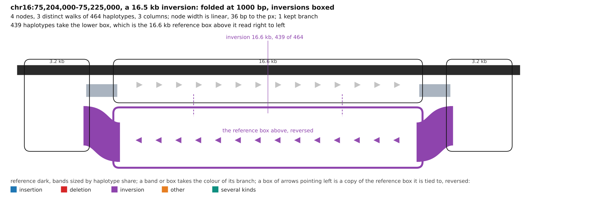
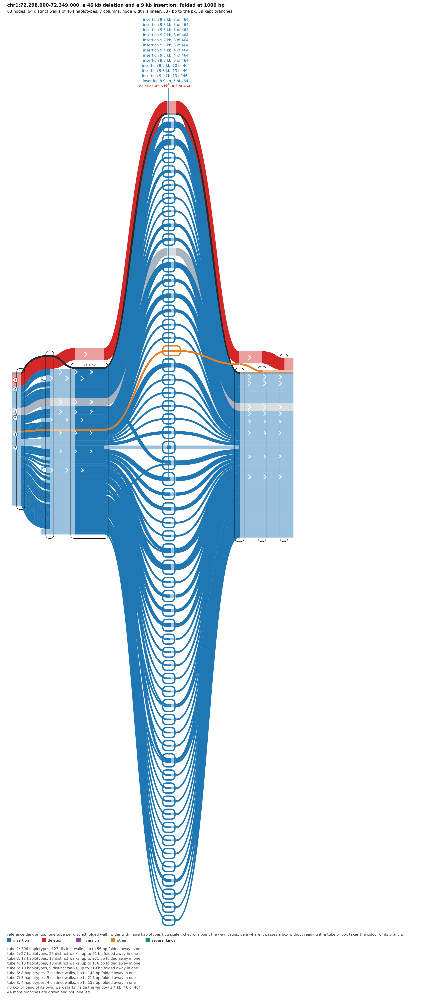

# How a window folds

## The rule

- The reference track is the backbone. Each other walk is read as runs: steps on
  reference nodes in one direction and in reference order. Small gaps do not end
  a run, so SNPs inside an inversion leave it one run
- Inside a run, a detour between two consecutive reference steps is big when its
  own length, or the reference it replaces, reaches the threshold. A big detour
  is kept; every other one is merged into the reference
  - own length big, replaced reference small: an insertion, drawn at the left
    breakpoint, and the walk passes the few replaced bp
  - replaced reference big, own length small: a deletion, a jump between two
    backbone nodes
  - both big: a replacement, kind `other`
- A run in the other direction is an inversion. It stays a block the walk takes
  reversed, `A -B C`, and is never a deletion
- Reference a walk passes more than once is a repeat, kind `other`, with the
  number of passes each carrier makes in `copies`. A reversed pass over
  reference the walk also passes another time is one of those passes and not an
  inversion: `A B -B C` walks `B` twice, once reversed. A reversed run is an
  inversion over the reference it alone walks
- Reference a walk leaves unwalked between two of its runs, as beside an
  inversion in `A -C -B E`, is a deletion when it reaches the threshold
- A run between two others that spans less reference than the threshold is not a
  run: its bp count as the walk's own sequence there. A repeat of reference
  shorter than the threshold folds the same way
- The first and last run of a walk are never dropped, so an inversion whose
  flanks are shorter than the threshold survives
- Sequence off the reference before a walk's first reference step or after its
  last never rejoins in the window, so it is kept however short. A walk that
  stops the threshold or more short of either end of the reference is drawn
  stopping there. What lies past such an end can be given, see
  [Open ends](runs.md#open-ends)
- A walk with no step on the reference in the window is one node of its own bp,
  `off:<walk>:<bp>`, `<walk>` being its index among the tracks. No other walk
  shares it, even one of the same bp or the same nodes: with no reference step,
  there is no site to name it by, and [runs](runs.md) carry no node names to
  tell two such walks apart. No branch reports it, since it has no position on
  the reference, and its bp are those the caller loaded
- The backbone is cut at every breakpoint a kept branch or run uses, and each
  piece between two cuts is one merged node
- Walks that fold to the same steps become one track whose `freq` is their sum
  and whose `haplotypes` counts their distinct haplotypes

## Stretches not loaded

A caller that cuts a window from a larger file may leave some stretches of a
walk unread and stand one node in for each, with the stretch's length. The fold
names a branch by its site and its bp and never reads the nodes inside it, so
such a node folds exactly as the loaded nodes it stands for would: the same
branch, shared with any other walk of that length at that site, and the same
cluster.

## Fragments

A haplotype can come into a window as several walks: two contigs of one
assembly, or two pieces of one contig. In chr3:162,650,000-163,050,000 HG03654#1
is two walks, so the window has 465 walks of 464 haplotypes. Give each walk its
haplotype and the fold counts it once:

```ts
const named = tracks.map(t => ({
  ...t,
  haplotype: t.name.split('#', 2).join('#'),
}))
```

- Walks that share a `haplotype` are one haplotype, counted once, as the largest
  `freq` among them. A walk without one is a haplotype of its own, `freq` of
  them, so a caller that passes none gets the counts it always had
- Name a haplotype only on a track that is one walk. A track that already merges
  several walks under its first walk's name, with `freq` counting them, stands
  for haplotypes whose names are gone; given that one name, it would merge with
  another of that haplotype's tracks and count as the larger `freq` alone. Leave
  `haplotype` off it and it counts as its `freq`
- The line above takes `sample#hap` from a PanSN name `sample#hap#contig` and
  leaves a name with fewer fields as it is. The fold reads no names itself,
  since not every name is PanSN
- A folded track's `freq` is the walks it holds, each by its `freq`, and its
  `haplotypes` the distinct haplotypes they are. Labels print `haplotypes`
- A haplotype whose walks fold to two tracks counts once on each, so the tracks'
  `haplotypes` can add up to more than the fold's `haplotypes`, which counts it
  once. A branch counts each haplotype once over all its tracks
- A haplotype with several walks on one track differs from it by what they
  differ by together, in `variation`
- Filled from the names, the chr3 window counts 464 haplotypes, and its
  deletions of 114 kb, 21.9 kb and 6.2 kb 239, 88 and 209 of 464. Unfilled, it
  counts 465

## Inversions

By default a carrier's walk is the true one, `A -B C`: it steps the reference
node `B` reversed, and a tube map draws the loop, as in the first picture.

With `inversions: 'box'` the carriers step through a copy of the block instead,
`A inv:B C`, in the direction they travel:



- Use the loop where tubes are drawn one per walk: it is the walk, and nothing
  is drawn twice. Use the box where the picture is banded, since bands are per
  step and draw the loop as two long edges under the block with nothing inside
  it
- A copy node has `kind: 'branch'`, the length and reference span of the node it
  copies, and `invertedOf`, that node's name. The inversion branch's `nodes`
  name the copies, and `members` lists what each holds
- **A renderer must mark a copy.** It is the reference box read backwards, not
  new sequence, and `invertedOf` is the only thing that says so. The picture
  above fills it with arrows against the reference and ties it to the box it
  copies
- A copy is named `inv:` and the node's name. Where an input node has that name
  already, the copy takes a `'` more until none does
- Which steps are the inverted pass is decided walk by walk: a run against the
  direction of the walk's first and last runs. A walk stored back to front with
  no inversion gets no copy, and one with an inversion steps `-inv:B`
- A block that another kept branch cuts is one copy per piece, in the order the
  carrier walks them. An insertion inside the block becomes a node of its own,
  `inv:ins:…`, with no `invertedOf`, listed in the insertion's `nodes` beside
  the node forward carriers take

## Clustering

One site of the chr1 window has insertions of 56 lengths from 8.9 to 9.5 kb on
129 haplotypes. Without clustering each is a box:



- With `cluster: true`, alleles of one kind join when their breakpoints and
  lengths each differ by at most `clusterTolerance` of the larger allele. The
  most carried allele is drawn, the others take its node
- Every clustered branch, and its node, carries
  `cluster: { members, minLength, maxLength, haplotypes }`, and the branch lists
  its `alleles`. `minLength` and `maxLength` are the shortest and longest
  allele's own bp: what it inserts, or what it deletes where it inserts nothing
- A walk drawn through a cluster keeps the difference in its `steps`, so its bp
  still reconcile
- Inversions are not clustered

## The gate

A run off the reference is a variant only when the reference passes each node
once. Where it does not, as in a graph with a collapsed repeat, the run may be a
copy of reference sequence, and the window comes back unfolded.

- `referenceRevisits` is the number of nodes the reference passes more than once
  anywhere in the graph, not in the window.
  [@gmod/gfa-tabix](https://github.com/GMOD/gfa-tabix-js) gives it as
  `tables.revisited`, which is the walk file header's count over the whole file.
  Above 0, the window is not folded
- Absent, 0 or NaN, which @gmod/gfa-tabix gives for a header with no count, the
  fold looks at the window alone: it is not folded if its reference track steps
  a node twice
- The count is 0 for Minigraph-Cactus and minigraph graphs, whose reference is
  acyclic. A pggb graph is refused only where its reference revisits a node: a
  pggb graph of four E. coli genomes whose header counts 0 folds, and is a test
  fixture here
- A window is also not folded when it has no reference track, or a track steps a
  node that is not among the nodes; `reason` names the track and node. Nor is it
  at a threshold under 1 bp, where every step on the reference would be a
  breakpoint
