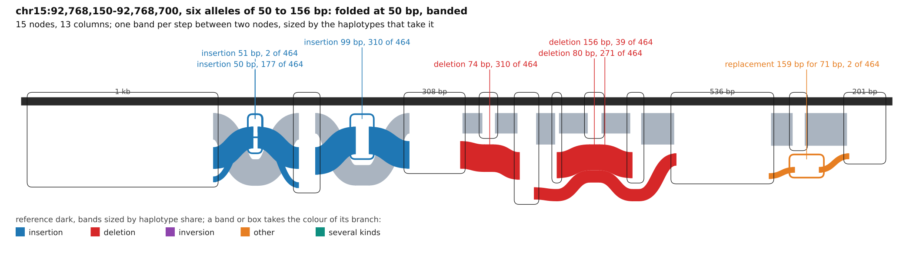
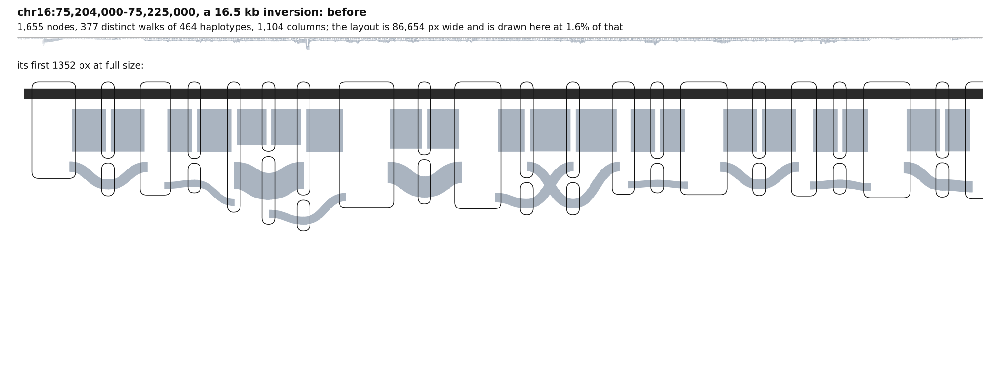
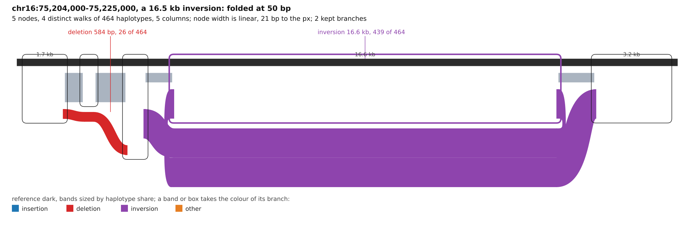
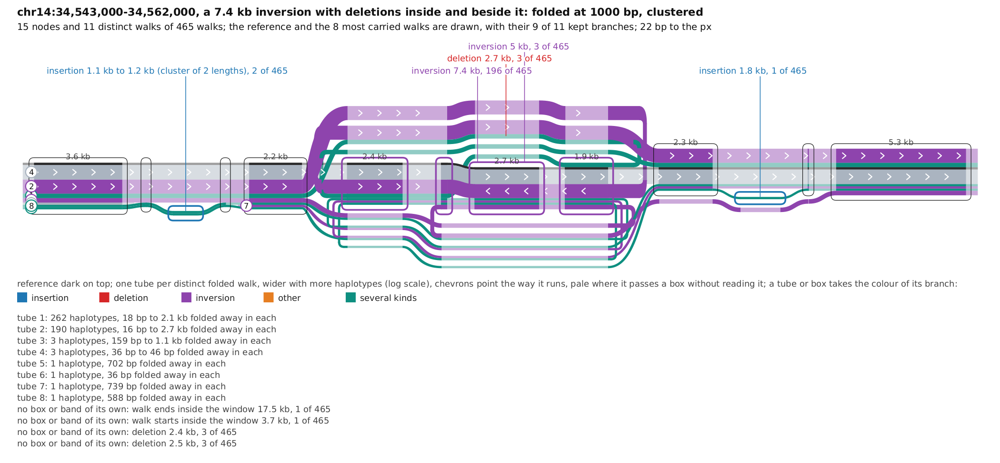
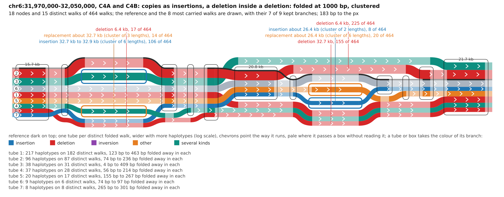
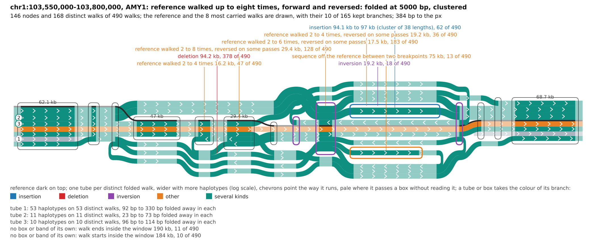

# Windows folded

## Three windows

HPRC v2.1 Minigraph-Cactus, GRCh38, 464 haplotypes, cut with graph-walks' figure
preset. Layout is tubemap-core's with `nodeWidthOption: 'compressed'`, banded by
`layers: [{ data: 'haplotypes', stat: 'coarsen' }]` and unbanded.

| window          | graph                               | nodes | distinct walks | columns, banded | px wide, banded | columns, unbanded | px wide, unbanded |
| --------------- | ----------------------------------- | ----- | -------------- | --------------- | --------------- | ----------------- | ----------------- |
| chr15-alleles   | before                              | 439   | 88             | 297             | 20,828          | 297               | 23,937            |
| chr15-alleles   | folded at 50 bp                     | 15    | 7              | 13              | 1,510           | 13                | 1,463             |
| chr15-alleles   | folded at 1000 bp                   | 1     | 2              | 1               | 135             | 1                 | 135               |
| chr1-deletion   | before                              | 1,906 | 279            | 1,381           | 114,413         | 1,381             | 124,219           |
| chr1-deletion   | folded at 50 bp                     | 65    | 64             | 9               | 1,686           | 9                 | 1,385             |
| chr1-deletion   | folded at 1000 bp                   | 63    | 64             | 7               | 1,458           | 7                 | 1,167             |
| chr1-deletion   | folded at 50 bp, clustered          | 10    | 6              | 9               | 1,309           | 9                 | 1,182             |
| chr1-deletion   | folded at 1000 bp, clustered        | 8     | 6              | 7               | 1,081           | 7                 | 982               |
| chr16-inversion | before                              | 1,655 | 377            | 1,104           | 86,654          | 1,104             | 156,585           |
| chr16-inversion | folded at 50 bp                     | 5     | 4              | 5               | 758             | 5                 | 742               |
| chr16-inversion | folded at 1000 bp                   | 3     | 3              | 3               | 504             | 3                 | 491               |
| chr16-inversion | folded at 1000 bp, inversions boxed | 4     | 3              | 3               | 463             | 3                 | 463               |

- chr15, folded at 50 bp: insertions of 50 bp (177 haplotypes), 51 bp (2) and 99
  bp (310), deletions of 74 bp (310), 80 bp (271) and 156 bp (39), and a 159 bp
  replacement (2). The reference is the minority allele at three sites
- chr1: the 45.5 kb deletion on 306 of 464 at every threshold tried
- chr16: the 16.6 kb inversion on 439 of 464 at 50, 1000 and 5000 bp, and a 584
  bp deletion on 26 at 50 bp
- Every fold passes `foldProblems`: all 464 haplotypes come out, every step is
  on a folded node, every jump is a reported branch, and every walk's bp
  reconcile

- The folded pictures are tubes, one per distinct folded walk, laid out with
  `nodeWidthOption: 'small'`, a `basesPerPixel` that fits the window and
  `freqWidth: 'log'`; linear makes the 439 haplotype tube 6,585 px wide
- chr15 reads better banded, above: its seven walks each carry several alleles,
  so a tube cannot take one branch's colour. `chr15-alleles-fold-50.png` is the
  same fold as tubes, and `chr1-deletion-fold-1000-clustered-banded.png` the
  chr1 fold banded
- `pnpm run fetch` cuts the windows and `pnpm prove` prints the table, checks
  the invariants and writes the pictures. `TUBEMAP_CORE` and `GRAPH_WALKS` name
  another build of either package for the scripts to import

## Duplications, inversions with structure, overlapping branches

Three more windows of the same graph, each folded at 50, 1000 and 5000 bp, with
and without clustering and with inversions boxed. `pnpm prove` checks the counts
below, which are those of graph-walks' departures over the same breakpoints.

- **chr14:34,543,000-34,562,000.** A 7.4 kb inversion on 196 haplotypes. Three
  more carry it with a 2.7 kb deletion inside the inverted block, and three
  invert 5 kb of it and leave 2.4 kb and 2.5 kb on either side unwalked, which
  are two deletions
- **chr6:31,970,000-32,050,000, C4A and C4B.** The graph holds the extra copies
  off the reference, so they fold as insertions of 26.4 kb and 32.7 kb and no
  walk revisits a reference node. The 32.7 kb deletion on 155 haplotypes spans
  the 6.4 kb deletion on 225
- **chr1:103,550,000-103,800,000, AMY1.** Walks pass the same reference up to
  eight times, forward and reversed. 378 walks take the 94.2 kb jump, 168 of
  them on two passes. Of its 167 distinct folded walks the picture draws the 8
  most carried

Also run and not in `pnpm prove`: GSTM1 (chr1:109,680,000-109,715,000), the
KIV-2 repeat of LPA (chr6:160,600,000-160,660,000), a 114 kb deletion holding a
21.9 kb one (chr3:162,650,000-163,050,000), and inversions at chr22:21.44 Mb,
chr7:63.36 Mb, chr16:1.23 Mb, chr11:4.23 Mb and chrX:155.38 Mb. Every fold
passes `foldProblems`, and at 1000 bp every deletion that is one jump has the
carriers, by haplotype name, of the departures over its breakpoints.
